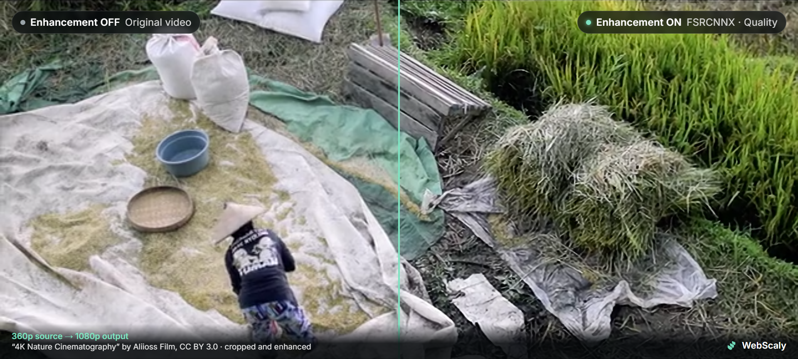
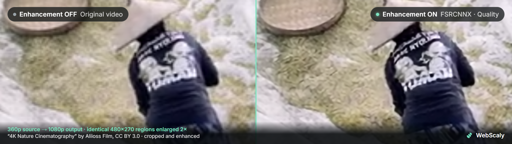
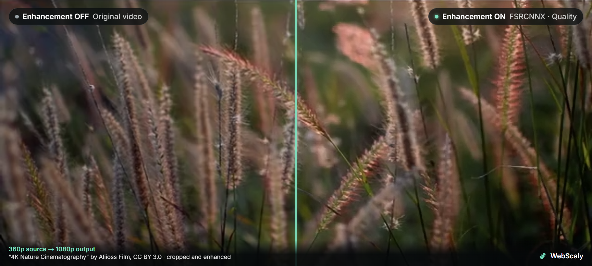
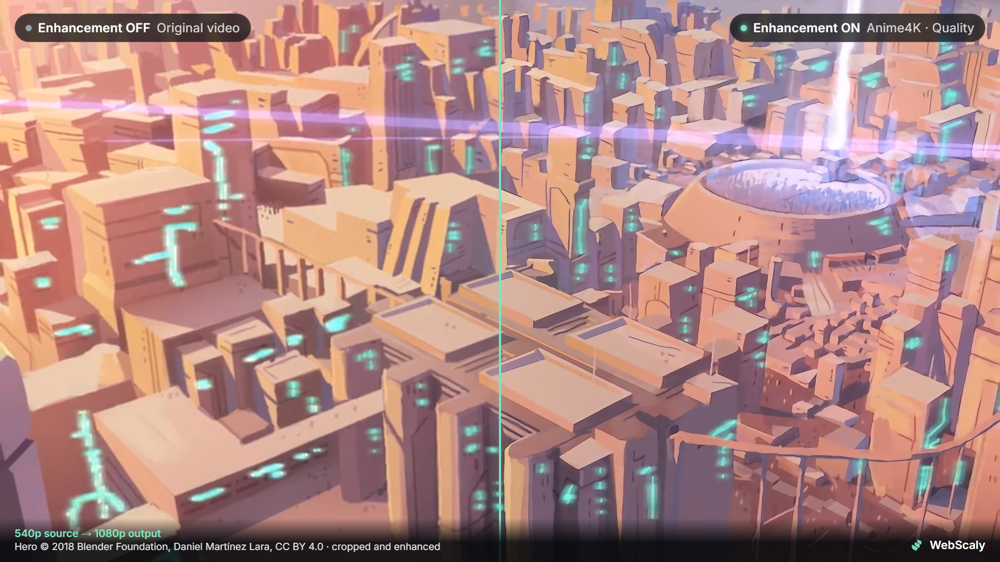
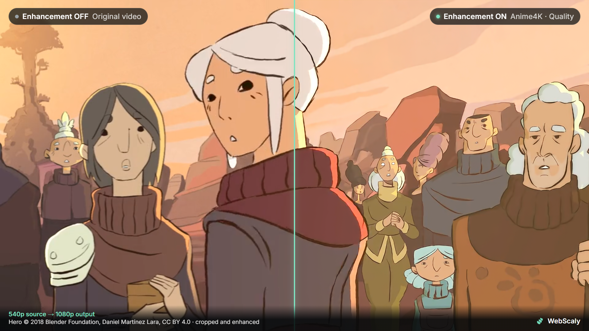
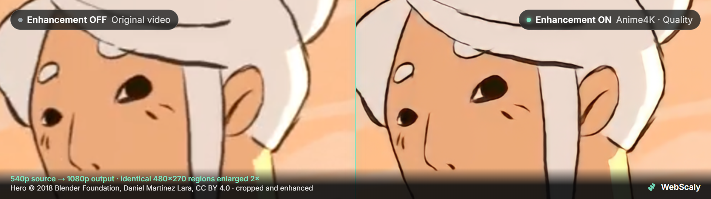

<p align="center"></p>

<h1 align="center">WebScaly</h1>
<p align="center">Local video enhancement for Chrome.</p>
<p align="center"><a href="https://chromewebstore.google.com/detail/webscaly/hdcnniaagmhkocoeahemlpgjecgpchfa"><strong>Install from the Chrome Web Store</strong></a> · <a href="#see-it-in-action">Watch the film</a> · <a href="#getting-started">Get started</a> · <a href="PRIVACY.md">Privacy</a> · <a href="SUPPORT.md">Support</a> · <a href="THIRD_PARTY_NOTICES.md">Licenses</a></p>

WebScaly is a Chrome extension that enhances accessible web video on websites you choose. It can sharpen detail, reduce light noise and upscale video while the website keeps control of playback and sound.

## Features

- **Enhancement:** Spatial Detail for any video, Anime4K for animation and FSRCNNX for learned 2× upscaling, each followed by a quality scaler (bicubic or Lanczos) and adaptive sharpening at display size.
- **Picture controls:** sharpening, denoise, deband, vibrance, contrast and brightness, per-site profiles, and built-in or custom presets.
- **Smart playback:** adaptive performance steps down when the GPU falls behind, sharp videos can be left untouched, battery saver applies while unplugged, and the popup suggests the engine that suits the content.
- **Player tools:** optional compact controls, comparison slider, hold-to-show-original, snapshots and performance HUD, all hidden initially.
- **Shortcuts and status:** keyboard shortcuts for on/off, comparison, engine and pause, and a per-tab ON badge on the toolbar icon.
- **Website access:** disabled by default. Embedded players require approval for both their own origin and the page hosting them.
- **Compatibility player:** explicitly share a source tab and select its video area for local enhancement when direct access is restricted. Audio stays in that tab.

Processing follows decoded frames at their native cadence. WebScaly does not generate intermediate frames or increase the source frame rate.

For the design and its limits, see [rendering, permissions and player integration](docs/LOCAL_VIDEO_ENHANCEMENT.md).

## See it in action

<video src="https://github.com/Lorcuz/WebScaly/raw/main/docs/media/webscaly-presentation-720p.mp4" poster="https://github.com/Lorcuz/WebScaly/raw/main/docs/media/webscaly-presentation-thumbnail.png" controls muted playsinline width="100%"></video>

A one-minute tour of WebScaly 0.4.0: allowing a website, choosing an engine, comparing in the player, each engine on footage that suits it, tuning the picture, and the smart and private defaults. [Download the MP4 (720p, 9 MB)](docs/media/webscaly-presentation-720p.mp4) · English captions ([SRT](docs/media/webscaly-presentation.en.srt) · [VTT](docs/media/webscaly-presentation.en.vtt)) · [All demonstrations](docs/media/README.md) · [Credits](docs/media/ATTRIBUTIONS.md)

## Before and after

All pictures below are WebScaly's own output, captured from a 360p or 540p stream played in Chrome and enhanced to 1080p. The left half is the original video with enhancement off; the right half is the same decoded frame with enhancement on. Nothing is sharpened or retouched afterwards.

### Real-life footage — FSRCNNX







### Animation — Anime4K







Both engines were set to Quality. Real-life frames come from the 360p encode of "4K Nature Cinematography" by Aliioss Film ([CC BY 3.0](https://creativecommons.org/licenses/by/3.0/)); animation frames come from the 540p encode of Hero, © 2018 Blender Foundation, Daniel Martínez Lara ([CC BY 4.0](https://creativecommons.org/licenses/by/4.0/)). Frames are cropped, resized and enhanced, and no endorsement is implied. Enhancement changes the appearance of a stream; it does not recover the original master, and results depend on the source and your graphics hardware. [More comparisons and full credits](docs/media/README.md).

## Privacy

Video processing happens on your device. There are no analytics, tracking scripts, accounts, cloud inference or automatic uploads. Website addresses, video frames and player diagnostics are handled locally to provide enhancement. Settings and approved sites stay in your browser.

You can remove website access at any time. GitHub, email, Discord and PayPal are optional services you can choose to open; their own privacy policies apply. Read the [privacy policy](PRIVACY.md) for storage, retention and support details.

## Getting started

### Chrome Web Store (recommended)

Use **Chrome 121+**. Install the published extension from the [official WebScaly Chrome Web Store page](https://chromewebstore.google.com/detail/webscaly/hdcnniaagmhkocoeahemlpgjecgpchfa):

1. Click **Add to Chrome** and confirm the installation.
2. Open a video website, click WebScaly and choose **Allow on this website** → **Allow**.
3. Choose an engine. If the video is embedded, approve its player website from the popup too. Press **Alt+Shift+E** to switch enhancement off and on.

Chrome handles updates to the store installation automatically. Website access starts off; approve only the websites you want to enhance.

The permission approval completes even when Chrome closes the popup. The settings gear opens the full settings for your current video profile, including a live before/after preview. Technical options have short help on hover or keyboard focus; Escape dismisses it.

### Build from source (for development)

Use **Node.js 22.12+ or 24 LTS**, npm and **Chrome 121+**.

```sh
npm ci
npm test
npm run build
```

1. Open `chrome://extensions` and enable **Developer mode**.
2. Choose **Load unpacked** and select the generated `dist` folder.
3. Follow the website approval and enhancement steps above.

To update an unpacked installation, rebuild and reload WebScaly on the extensions page, then refresh your video tabs. You can also extract the extension ZIP from [GitHub Releases](https://github.com/Lorcuz/WebScaly/releases/latest) and load it as an unpacked extension.


### Compatibility and limits

WebScaly supports accessible HTML5 video and common player layouts. Neural algorithms need a supported WebGPU device; a WebGL spatial fallback is available when possible. Quality and speed depend on the video, browser and GPU.

Protected media, browser pixel-access restrictions, unapproved embedded players and inaccessible player internals can prevent enhancement. Native video fullscreen may show the original video; container fullscreen can retain enhancement. The compatibility player requires an explicit Chrome tab-sharing choice, and protected content can still remain black.

This release does not promise support for every website or GPU. See [compatibility results](docs/COMPATIBILITY.md) for tested, partial and unverified cases.

## Develop, test and package

```sh
npx playwright install chromium
npm run test:browser
npm run package
```

Browser tests use original generated footage and isolated profiles. Raw profiles, screenshots and device reports belong in ignored `test-results/`. See [testing](docs/TESTING.md), [architecture](docs/ARCHITECTURE.md) and [contributing](CONTRIBUTING.md).

`npm run package` produces `release/webscaly-<version>.zip`, a corresponding-source archive and a clean public source tree. The extension ZIP contains runtime files and required license/source material. Packaging validates the runtime allowlist and recursively scans corresponding source for private paths, credentials and retired runtime files. `npm run verify:release` checks the extracted ZIP's interface and asset loading; `npm run verify:source` installs and rebuilds from its bundled source and compares every runtime file. [CHROMEWEBSTORE.md](CHROMEWEBSTORE.md) contains the published listing link, store copy, permission explanations and future-update instructions.

## Support and feedback

Report a reproducible problem through [GitHub Issues](https://github.com/Lorcuz/webscaly/issues), email [notlorcuz@gmail.com](mailto:notlorcuz@gmail.com), or contact [Lorcuz on Discord](https://discord.com/users/754255237195235369). Avoid posting personal configuration exports, private video addresses or browser profiles. For security issues, use the private email process in [SECURITY.md](SECURITY.md).

Optional PayPal support is available from **Settings → About → Support WebScaly**. A donation is never required to use the extension.

## License

WebScaly-authored code and its scale logo use the [MIT License](LICENSE). Bundled third-party material retains its own license. In particular, the FSRCNNX weights and derived shaders are **LGPL-3.0-or-later**; the package includes corresponding source, notices and rebuild/replacement instructions. See [THIRD_PARTY_NOTICES.md](THIRD_PARTY_NOTICES.md). The MIT license does not relicense those components.

Demonstration media has separate credits and terms in [docs/media/ATTRIBUTIONS.md](docs/media/ATTRIBUTIONS.md); the code license does not relicense the demonstration footage or music.

<p align="center">Built in Italy 🇮🇹<br><sub>by Lorenzo Gresio</sub></p>
