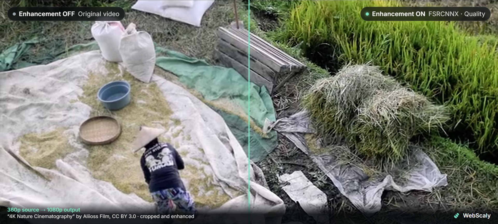
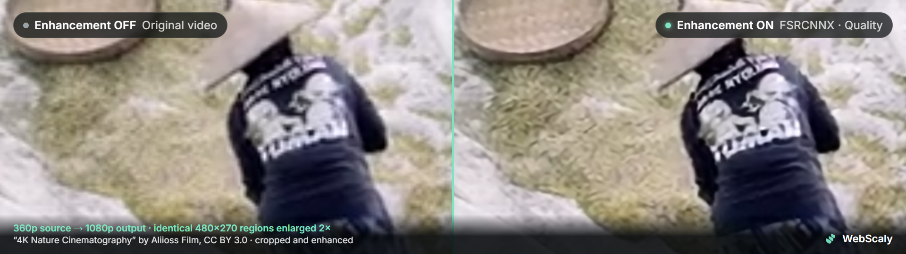
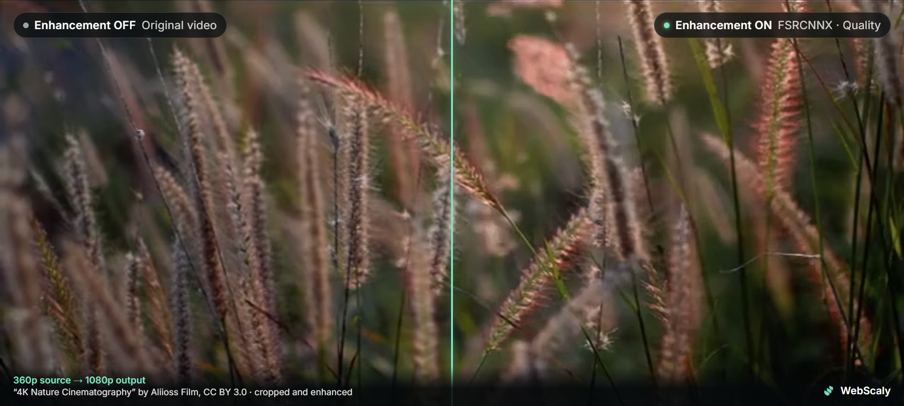
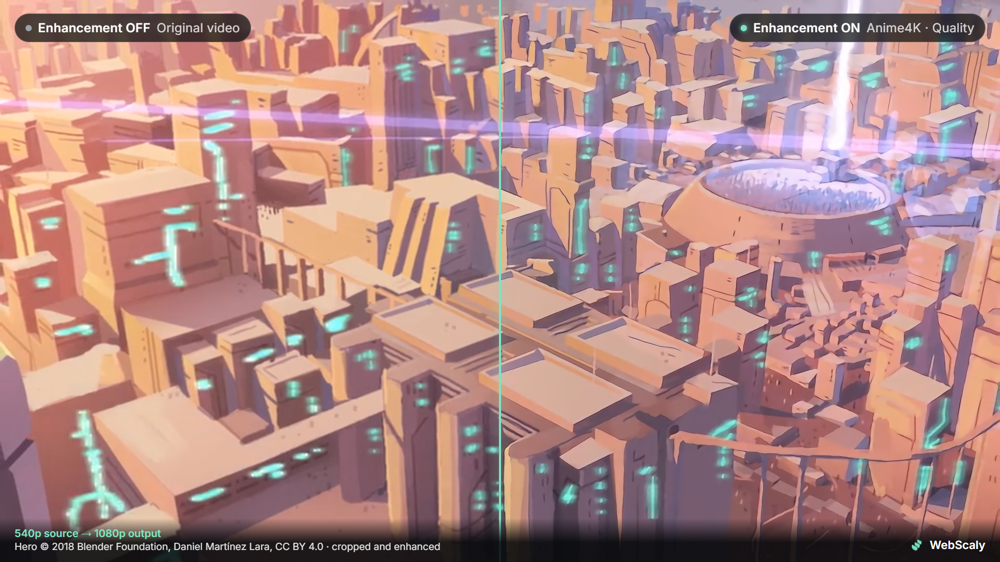
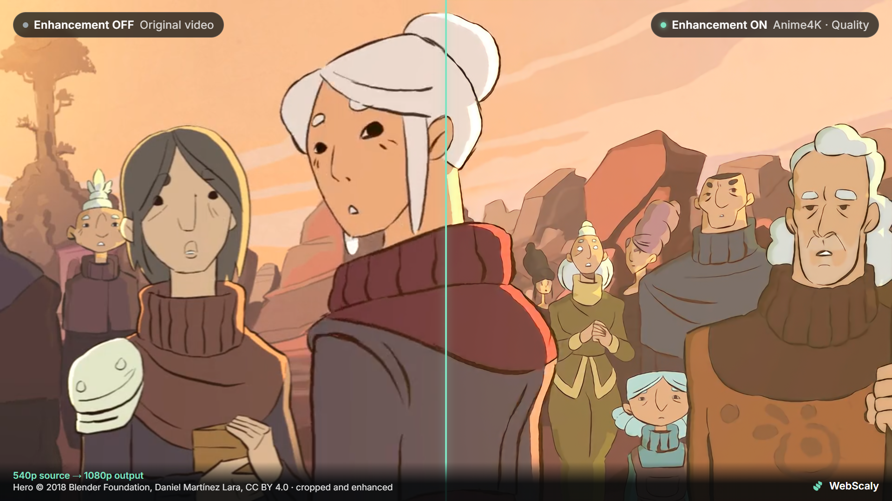
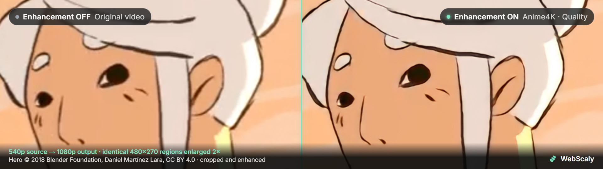
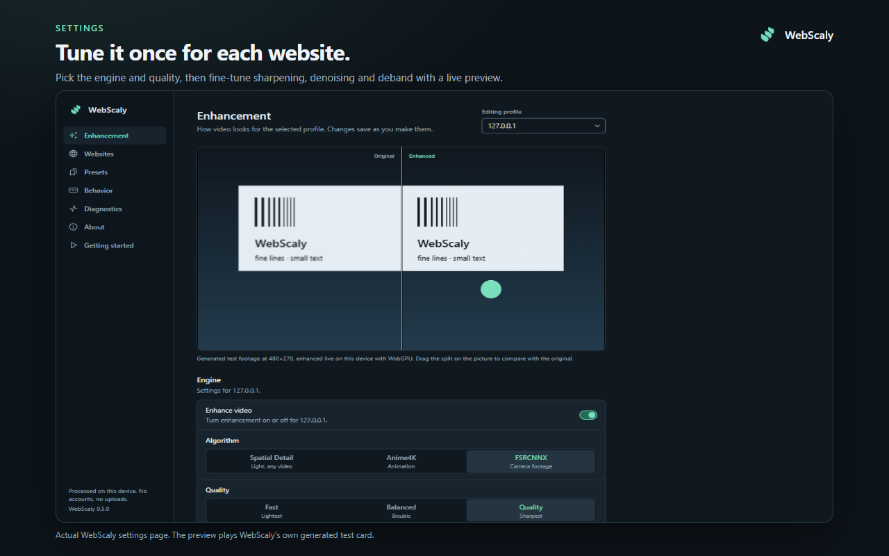

<p align="center"></p>

<h1 align="center">WebScaly</h1>
<p align="center">Local video enhancement for Chrome.</p>
<p align="center"><a href="https://chromewebstore.google.com/detail/webscaly/hdcnniaagmhkocoeahemlpgjecgpchfa"><strong>Install from the Chrome Web Store</strong></a> · <a href="#see-it-in-action">Watch the film</a> · <a href="#getting-started">Get started</a> · <a href="PRIVACY.md">Privacy</a> · <a href="SUPPORT.md">Support</a> · <a href="THIRD_PARTY_NOTICES.md">Licenses</a></p>

WebScaly is a Chrome extension that enhances accessible web video on websites you choose. It sharpens detail, reduces light noise and banding, and upscales video on your own graphics card, while the website's player keeps control of playback and sound.

## Features

- **Three engines:** Spatial Detail for any video, Anime4K for animation and FSRCNNX for learned 2× upscaling of camera footage. Each is followed by a quality scaler (bicubic or Lanczos) and adaptive sharpening at your display size.
- **Picture controls:** sharpening, denoise, deband, vibrance, contrast and brightness, per-website profiles, and built-in or custom presets.
- **Smart playback:** adaptive performance steps down when the graphics card falls behind instead of stuttering, already-sharp videos can be left untouched, battery saver applies while unplugged, and the popup suggests the engine that suits the content without switching by itself.
- **Player tools:** optional compact controls, comparison slider, hold-to-show-original, snapshots and a performance HUD, all hidden until you turn them on.
- **Shortcuts and status:** keyboard shortcuts for on/off, comparison, engine and pause, and a per-tab badge on the toolbar icon.
- **Website access:** off by default. You allow each website yourself; an embedded player needs approval for its own website and for the page that hosts it.
- **Compatibility player:** when direct access is restricted, share a source tab yourself and select its video area for local enhancement. Audio stays in that tab.

Processing follows decoded frames at their native cadence. WebScaly does not generate intermediate frames or increase the source frame rate.

For the design and its limits, see [rendering, permissions and player integration](docs/LOCAL_VIDEO_ENHANCEMENT.md).

## See it in action

https://github.com/user-attachments/assets/3110377b-ab5e-4bab-959b-4a9ba016e71f

A one-minute tour, recorded on 0.4.0 (some labels have changed since): allowing a website, choosing an engine, comparing in the player, each engine on footage that suits it, tuning the picture, and the smart and private defaults. [Download the MP4 (720p, 9 MB)](docs/media/webscaly-presentation-720p.mp4) · English captions ([SRT](docs/media/webscaly-presentation.en.srt) · [VTT](docs/media/webscaly-presentation.en.vtt)) · [All demonstrations](docs/media/README.md) · [Credits](docs/media/ATTRIBUTIONS.md)

## Before and after

All pictures below are WebScaly's own output, captured from a 360p or 540p stream played in Chrome and enhanced to 1080p. The left half is the original video with enhancement off; the right half is the same decoded frame with enhancement on. Nothing is sharpened or retouched afterwards.

### Real-life footage — FSRCNNX







### Animation — Anime4K







Both engines were set to Quality. Real-life frames come from the 360p encode of "4K Nature Cinematography" by Aliioss Film ([CC BY 3.0](https://creativecommons.org/licenses/by/3.0/)); animation frames come from the 540p encode of Hero, © 2018 Blender Foundation, Daniel Martínez Lara ([CC BY 4.0](https://creativecommons.org/licenses/by/4.0/)). Frames are cropped, resized and enhanced, and no endorsement is implied. Enhancement changes the appearance of a stream; it does not recover the original master, and results depend on the source and your graphics hardware. [More comparisons and full credits](docs/media/README.md).

## Privacy

Video is processed on your device. There are no analytics, tracking scripts, accounts, cloud processing or automatic uploads.

To work, WebScaly handles on your device:

- **the address of the current website and of approved websites,** to show the current website and enforce your approvals;
- **decoded video frames,** to enhance them; frames are not stored, except a snapshot you save yourself to your downloads;
- **your settings, approved websites and presets,** kept in Chrome's local extension storage (not synced to your Google account);
- **temporary tab and frame context and local diagnostics,** kept in memory or in session storage, and cleared when Chrome closes.

None of this is sent to the developer or anyone else. WebScaly's use of this information complies with the Chrome Web Store User Data Policy, including its Limited Use requirements. You can remove website access at any time.

GitHub, email, Discord and PayPal are optional services you can choose to open; their own privacy policies apply. Read the [privacy policy](PRIVACY.md) for storage, retention and support details.

## Permissions

| Permission | Why WebScaly needs it |
| --- | --- |
| `activeTab` | Read the current website's address when you open WebScaly or press a shortcut, so the popup can offer **Allow on this website**. |
| `scripting` | Run WebScaly's bundled enhancement script only on websites you approved. |
| `storage` | Keep your settings, approvals and presets on your device. |
| Optional `http://*/*`, `https://*/*` | Ask Chrome for access to one website at a time, only after you choose **Allow**. Nothing is granted at installation. |

WebScaly does not download or run remote code. Keyboard shortcuts use Chrome's `commands` key, which is not a permission.

## Getting started

### Chrome Web Store (recommended)

Use **Chrome 121 or newer**. Install the published extension from the [official WebScaly Chrome Web Store page](https://chromewebstore.google.com/detail/webscaly/hdcnniaagmhkocoeahemlpgjecgpchfa):

1. Click **Add to Chrome** and confirm the installation.
2. Open a video website, click WebScaly and choose **Allow on this website** → **Allow**.
3. Choose an engine. If the video is embedded, approve its player website from the popup too. Press **Alt+Shift+E** to switch enhancement off and on.

Chrome updates store installations automatically. Website access starts off; approve only the websites you want to enhance.

The approval completes even when Chrome closes the popup. The settings gear opens the full settings for your current video profile, including a live before/after preview. Technical options have short help on hover or keyboard focus; Escape dismisses it.

### Build from source (for development)

Use **Node.js 22.12+ or 24 LTS**, npm and **Chrome 121 or newer**.

```sh
npm ci
npm test
npm run build
```

1. Open `chrome://extensions` and enable **Developer mode**.
2. Choose **Load unpacked** and select the generated `dist` folder.
3. Follow the website approval and enhancement steps above.

To update an unpacked installation, rebuild and reload WebScaly on the extensions page, then refresh your video tabs. You can also download `webscaly-<version>.zip` from [GitHub Releases](https://github.com/Lorcuz/WebScaly/releases/latest), extract it and load the folder as an unpacked extension. The matching `webscaly-<version>-source.zip` holds the corresponding source.



## Requirements and limits

- **Browser:** Chrome 121 or newer.
- **Graphics:** Anime4K and FSRCNNX need WebGPU. Without it, WebScaly uses a lighter WebGL version of Spatial Detail when possible. Plain `http://` pages do not offer WebGPU, so they use the WebGL fallback.
- **Tested hardware:** development and benchmarks use one Windows 11 machine with an NVIDIA GPU. AMD and Intel GPUs, macOS, Linux and ChromeOS have not been tested.
- **Videos that cannot be enhanced:** protected (DRM) video, video from another origin that the browser does not let extensions read, players inside closed Shadow DOM, and embedded players whose website you have not approved. Protected video is left untouched and marked "Protected".
- **Fullscreen:** native video-element fullscreen shows the original video; the player's own fullscreen keeps enhancement.
- **Background tabs:** after 60 s in the background a tab releases its graphics pipeline; when you return, the original video shows briefly while it rebuilds.
- **After re-enabling the extension,** refresh open video tabs so the player attaches again.

WebScaly does not promise support for every website or GPU. See [compatibility results](docs/COMPATIBILITY.md) for tested, partial and unverified cases.

## Develop, test and package

```sh
npx playwright install chromium
npm run lint
npm run test:browser
npm run package
```

The GitHub Actions workflow runs the unit tests, lint, build, package and a dependency audit. Browser and GPU tests need a real graphics device and run locally; see [testing](docs/TESTING.md). Browser tests use original generated footage and isolated profiles, and raw output stays in the ignored `test-results/` folder. See also [architecture](docs/ARCHITECTURE.md) and [contributing](CONTRIBUTING.md).

`npm run package` produces `release/webscaly-<version>.zip`, a corresponding-source archive and a clean public source tree. The extension ZIP contains runtime files and the required license and source material. Packaging validates the runtime allowlist and recursively scans the corresponding source for private paths, credentials and retired runtime files. `npm run verify:release` checks the extracted ZIP's interface and asset loading; `npm run verify:source` installs and rebuilds from its bundled source and compares every runtime file. [CHROMEWEBSTORE.md](CHROMEWEBSTORE.md) holds the store listing text, permission explanations and update instructions.

## Support and feedback

Report a reproducible problem through [GitHub Issues](https://github.com/Lorcuz/WebScaly/issues), email [notlorcuz@gmail.com](mailto:notlorcuz@gmail.com), or contact [Lorcuz on Discord](https://discord.com/users/754255237195235369). Avoid posting configuration exports, private video addresses or browser profiles. For security issues, use the private email process in [SECURITY.md](SECURITY.md). See [SUPPORT.md](SUPPORT.md) for what to include.

Optional PayPal support is available from **Settings → About → Support WebScaly**. A donation is never required to use the extension.

## License

WebScaly-authored code and its scale logo use the [MIT License](LICENSE). Bundled third-party material keeps its own license. In particular, the FSRCNNX weights and derived shaders are **LGPL-3.0-or-later**; the package includes corresponding source, notices and rebuild/replacement instructions. See [THIRD_PARTY_NOTICES.md](THIRD_PARTY_NOTICES.md). The MIT license does not relicense those components.

Demonstration media has separate credits and terms in [docs/media/ATTRIBUTIONS.md](docs/media/ATTRIBUTIONS.md); the code license does not relicense the demonstration footage or music.

<p align="center">Built in Italy 🇮🇹<br><sub>by Lorenzo Gresio</sub></p>
