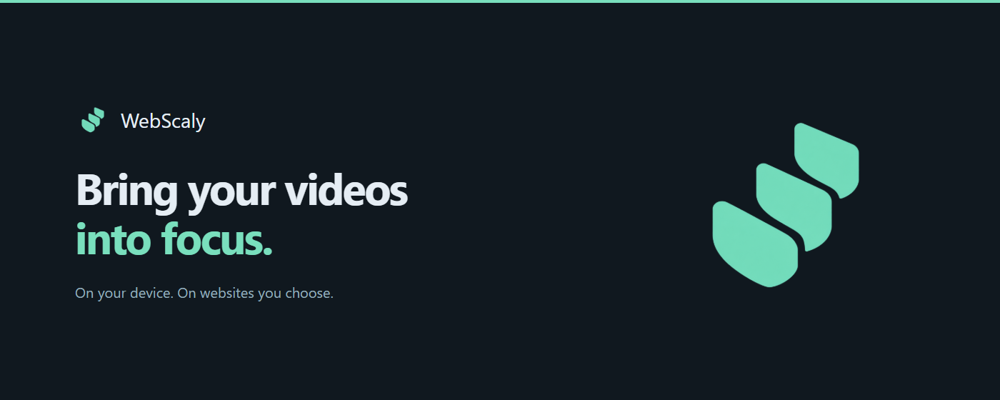

<p align="center"></p>

<h1 align="center">WebScaly</h1>
<p align="center">Bring more detail to the videos you watch. Keep processing on your device.</p>
<p align="center"><a href="#getting-started">Get started</a> · <a href="PRIVACY.md">Privacy</a> · <a href="SUPPORT.md">Support</a> · <a href="THIRD_PARTY_NOTICES.md">Licenses</a></p>



WebScaly is a Chrome extension that enhances accessible web video on websites you choose. It can sharpen detail, reduce light noise and upscale video while the website keeps control of playback and sound.

## What you can do

- **Choose the right enhancement.** Spatial Detail offers light sharpening and denoise, Anime4K restores animation, and FSRCNNX reconstructs finer detail at 2×.
- **Make it your own.** Adjust quality, output size and spatial strength. Save different settings for different websites.
- **Compare when you want.** Optional player controls, a comparison slider and a performance HUD start hidden.
- **Approve only the websites you need.** Access starts off. Embedded players need approval for both their own website and the page hosting them.
- **Try the compatibility player.** When direct video access is restricted, explicitly share the source tab and select the video area for local enhancement. Original audio stays in that tab.


## Privacy comes first

Video processing happens on your device. There are no analytics, tracking scripts, accounts, cloud inference or automatic uploads. Website addresses, video frames and player diagnostics are handled locally to provide enhancement. Settings and approved sites stay in your browser.

You can remove website access at any time. Email, Discord and PayPal are optional services you can choose to open; their own privacy policies apply. Read the [privacy policy](PRIVACY.md) for storage, retention and support details.

## Getting started

### Build and load the extension

Use **Node.js 22.12+ or 24 LTS**, npm and **Chrome 121+**.

```sh
npm ci
npm test
npm run build
```

1. Open `chrome://extensions` and enable **Developer mode**.
2. Choose **Load unpacked** and select the generated `dist` folder.
3. Open a video website, click WebScaly and choose **Add this website** → **Allow**.
4. Turn on **Enhancement** and choose an algorithm. If the video is embedded, approve its player website from the popup too.

The permission approval completes even when Chrome closes the popup. The settings gear opens advanced settings for your current video profile. Technical options have short help on hover or keyboard focus; Escape dismisses it.

To update an unpacked installation, reload WebScaly on the extensions page and refresh your video tabs. A published release ZIP can also be extracted and loaded as an unpacked extension.


### Compatibility and limits

WebScaly supports accessible HTML5 video and common player layouts. Neural algorithms need a supported WebGPU device; a WebGL spatial fallback is available when possible. Quality and speed depend on the video, browser and GPU.

Protected media, browser pixel-access restrictions, unapproved embedded players and inaccessible player internals can prevent enhancement. Native video fullscreen may show the original video; container fullscreen can retain enhancement. The compatibility player requires an explicit Chrome tab-sharing choice, and protected content can still remain black.

This release does not promise support for every website or GPU. See [compatibility results](docs/COMPATIBILITY.md) for tested, partial and unverified cases.

## Develop, test and package

```sh
npx playwright install chromium
npm run test:browser
npm run package
```

Browser tests use original generated footage and isolated profiles. Raw profiles, screenshots and device reports belong in ignored `test-results/`. See [testing](docs/TESTING.md), [architecture](docs/ARCHITECTURE.md) and [contributing](CONTRIBUTING.md).

`npm run package` produces `release/webscaly-0.3.0.zip`, a corresponding-source archive and a clean public source tree. The extension ZIP contains runtime files and required license/source material. Packaging validates the runtime allowlist and recursively scans corresponding source for private paths, credentials and retired runtime files. `npm run verify:release` checks the extracted ZIP's interface and asset loading; `npm run verify:source` installs and rebuilds from its bundled source and compares every runtime file. [CHROMEWEBSTORE.md](CHROMEWEBSTORE.md) contains store copy, permission explanations and submission instructions.

## Support and feedback

Report a reproducible problem through [GitHub Issues](https://github.com/Lorcuz/webscaly/issues), email [notlorcuz@gmail.com](mailto:notlorcuz@gmail.com), or contact [Lorcuz on Discord](https://discord.com/users/754255237195235369). Avoid posting personal configuration exports, private video addresses or browser profiles. For security issues, use the private email process in [SECURITY.md](SECURITY.md).

Optional PayPal support is available from **Settings → About → Support WebScaly**. A donation is never required to use the extension.

## License

WebScaly-authored code and its scale logo use the [MIT License](LICENSE). Bundled third-party material retains its own license. In particular, the FSRCNNX weights and derived shaders are **LGPL-3.0-or-later**; the package includes corresponding source, notices and rebuild/replacement instructions. See [THIRD_PARTY_NOTICES.md](THIRD_PARTY_NOTICES.md). The MIT license does not relicense those components.

<p align="center">Built in Italy 🇮🇹<br><sub>by Lorenzo Gresio</sub></p>
