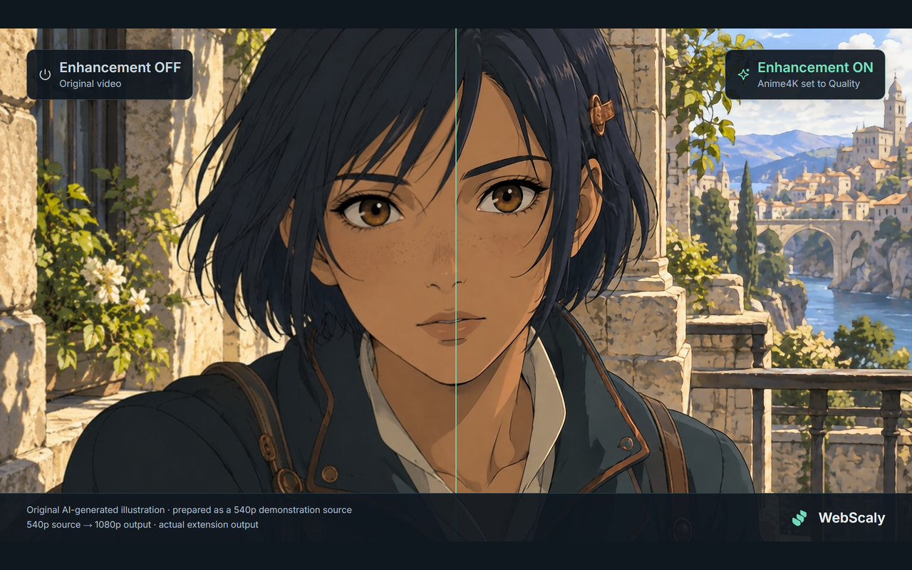
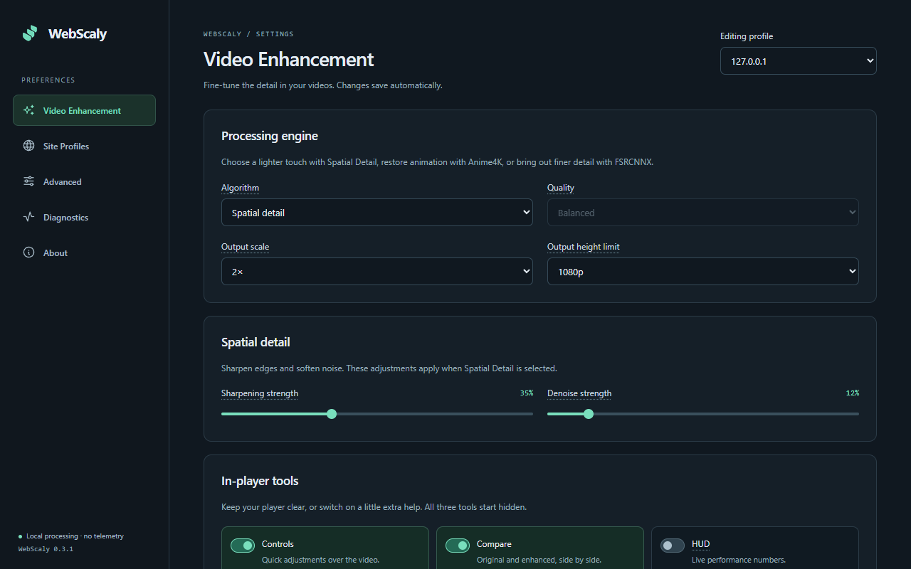

<p align="center"></p>

<h1 align="center">WebScaly</h1>
<p align="center">Video enhancement, on your device.</p>
<p align="center"><a href="https://chromewebstore.google.com/detail/webscaly/hdcnniaagmhkocoeahemlpgjecgpchfa"><strong>Install from the Chrome Web Store</strong></a> · <a href="#see-it-in-action">Watch the demo</a> · <a href="PRIVACY.md">Privacy</a> · <a href="SUPPORT.md">Support</a></p>

WebScaly is a free, open-source Chrome extension that sharpens and upscales accessible web video on websites you approve. Enhancement runs locally while your usual player handles playback and sound.



*Original demonstration illustration. Same decoded frame, 960×540 source → 1920×1080 output with Anime4K Quality. [Capture details and credits](docs/media/ATTRIBUTIONS.md).*

## Getting started

Use **Chrome 121+** and install WebScaly from the [Chrome Web Store](https://chromewebstore.google.com/detail/webscaly/hdcnniaagmhkocoeahemlpgjecgpchfa). Chrome keeps the store installation updated automatically.

1. Open a video website and click WebScaly in the toolbar.
2. Choose **Add this website** → **Allow** in Chrome. If the video is embedded, approve the player website shown in the popup too.
3. Turn on **Enhancement** and choose an algorithm and quality.

Website access starts off. Approve only the websites you want to enhance, and remove access whenever you want. Approval completes even if Chrome closes the popup.

The settings gear opens the current site's profile. **Controls**, **Compare** and **HUD** stay hidden until you enable them; Compare lets you inspect the original and enhanced picture in the same player.

## See it in action

The 58-second showcase covers website approval, Anime4K Quality, real OFF/ON comparisons, player tools and site profiles. It has on-screen explanations and no audio.

https://github.com/user-attachments/assets/56674f4d-dd3f-478f-b941-17387b18f4fa

[Download the 1080p video](https://raw.githubusercontent.com/Lorcuz/WebScaly/main/docs/media/WebScaly-showcase-1080p.mp4) · [English captions](https://github.com/Lorcuz/WebScaly/blob/main/docs/media/WebScaly-showcase.en.vtt) · [Comparison gallery and full-size images](https://github.com/Lorcuz/WebScaly/blob/main/docs/media/README.md)


*Identical eye and hair crops enlarged equally to make edges easier to compare. The ON side comes from WebScaly's Anime4K Quality output. No extra sharpening was applied in the editor.*

## Enhancement options

| Algorithm | Use it for |
| --- | --- |
| **Spatial Detail** | Lightweight sharpening and light denoise. Adjust the strengths in settings. |
| **Anime4K** | Animation and illustrated footage, using bundled restore/upscale shaders. |
| **FSRCNNX** | Learned 2× upscaling for finer detail. |

Adjust quality, output scale and height limits to suit the video and your device. Save different settings for different websites. Sharpening and denoise strengths apply to Spatial Detail; neural weights use their fixed processing strength.

WebScaly follows decoded video frames at their native cadence. It does not generate intermediate frames or increase the source frame rate.

<details>
<summary>View enhancement settings</summary>



</details>

## Privacy and website access

Video processing happens on your device. There are **no accounts, analytics, tracking scripts, cloud processing or automatic uploads**. Settings and approved websites stay in your browser. Frames and local diagnostics are used to provide enhancement.

An embedded player needs approval for both its own origin and the website hosting it. Removing either approval stops enhancement for that page. The optional compatibility player requires an explicit Chrome tab-sharing choice; audio remains in the source tab.

External support links open only when you select them and have their own privacy policies. Read [PRIVACY.md](PRIVACY.md) for local storage, retention and support details.

## Compatibility

WebScaly works with accessible HTML5 video and common player layouts. Anime4K and FSRCNNX require a supported WebGPU device; a WebGL spatial fallback is available where supported. Quality and speed depend on the source, browser and GPU.

Protected media, browser pixel-access rules and inaccessible player internals can prevent enhancement. Native video-element fullscreen may show the original picture; container fullscreen can retain enhancement. The compatibility player can help with restricted direct access, but protected content can still appear black.

See [recorded compatibility results](docs/COMPATIBILITY.md) for tested, partial and unverified cases. Support is not guaranteed for every website or GPU. [Rendering and permission design](docs/LOCAL_VIDEO_ENHANCEMENT.md) explains how it works.

## Build and contribute

For development, use **Node.js 22.12+ or 24 LTS**, npm and Chrome 121+:

```sh
npm ci
npm test
npm run build
```

Open `chrome://extensions`, enable **Developer mode**, choose **Load unpacked** and select `dist`. After rebuilding, reload the extension and refresh video tabs. An unpacked ZIP is also available in [GitHub Releases](https://github.com/Lorcuz/WebScaly/releases/latest).

Browser checks and packaging:

```sh
npx playwright install chromium
npm run test:browser
npm run package
```

Packaging uses explicit allowlists and checks the extension and corresponding source for private data. `npm run verify:release` checks the extracted build; `npm run verify:source` rebuilds its bundled source and compares runtime files. Raw browser profiles and device reports belong in ignored `test-results/`.

[Contributing](CONTRIBUTING.md) · [Testing](docs/TESTING.md) · [Architecture](docs/ARCHITECTURE.md) · [Store maintenance](CHROMEWEBSTORE.md)

## Support

Report reproducible bugs through [GitHub Issues](https://github.com/Lorcuz/WebScaly/issues), email [notlorcuz@gmail.com](mailto:notlorcuz@gmail.com), or contact [Lorcuz on Discord](https://discord.com/users/754255237195235369). Include the player, algorithm and steps to reproduce; omit private video addresses and personal configuration exports. Use the private process in [SECURITY.md](SECURITY.md) for security issues.

Optional PayPal support is available in **Settings → About → Support WebScaly**. Donations are never required.

## License

WebScaly-authored code and the scale logo use the [MIT License](LICENSE). Bundled components retain their own licenses: FSRCNNX weights and derived shaders remain **LGPL-3.0-or-later**, with corresponding source and rebuild instructions. See [third-party notices](THIRD_PARTY_NOTICES.md).

Demonstration media has separate credits and terms in [the asset attribution](docs/media/ATTRIBUTIONS.md); the code license does not relicense the Hero film.

<p align="center">Built in Italy 🇮🇹<br><sub>by Lorenzo Gresio</sub></p>
