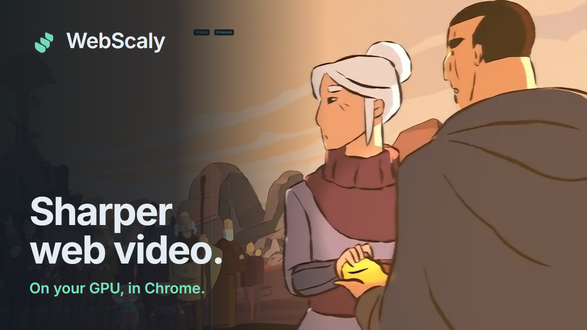

# WebScaly demonstrations

[Install from the Chrome Web Store](https://chromewebstore.google.com/detail/webscaly/hdcnniaagmhkocoeahemlpgjecgpchfa) · [Project README](../../README.md) · [Credits and capture details](ATTRIBUTIONS.md)

## Presentation film — WebScaly 0.4.0

**▶ Click the picture to play the film** (720p, plays in your browser).

| File | Details |
| --- | --- |
| [webscaly-presentation-720p.mp4](webscaly-presentation-720p.mp4) | 69 seconds · 1280×720 · 30 fps · H.264 and AAC stereo · 9.5 MB |
| [webscaly-presentation.en.srt](webscaly-presentation.en.srt) | English captions, SubRip |
| [webscaly-presentation.en.vtt](webscaly-presentation.en.vtt) | English captions, WebVTT |
| [webscaly-presentation-thumbnail.png](webscaly-presentation-thumbnail.png) | 1280×720 cover |

| Time | What the film shows |
| --- | --- |
| 0:00 | WebScaly's own comparison divider sweeping across a 640×360 stream: original on the left, Anime4K on the right |
| 0:06 | Title |
| 0:10 | One decoded frame: browser playback beside WebScaly Anime4K, equal crop and enlargement |
| 0:16 | Allowing a website from the popup; Chrome's own Allow prompt is described, not shown |
| 0:21 | The engine suggestion, Use Anime4K, then Compare and Controls |
| 0:26 | Dragging the comparison slider in the player |
| 0:32 | The same frame through Spatial Detail, Anime4K and FSRCNNX |
| 0:36 | Spatial Detail on NASA footage of Earth from the International Space Station |
| 0:41 | FSRCNNX on real camera footage of grass seed heads |
| 0:45 | Dragging Sharpening in settings while the live preview responds |
| 0:50 | Adaptive performance, pause and battery saver, keyboard shortcuts, the HUD |
| 0:57 | Runs on your device, only on websites you approve |
| 1:02 | Installation and credits |

How it was made:

- Every enhanced picture and interface state is a capture of the WebScaly 0.4.0 build running in Chromium with WebGPU. The pointer is drawn in editing at the positions of the recorded clicks and drags.
- The demonstration website is a local test page whose access was granted ahead of time in an isolated profile. Every clip it plays, Hero, the ISS view and the nature footage, was downscaled and encoded as a 640×360 stream before playback.
- Both sides of every comparison come from the same decoded frame, with identical crops and enlargement. Nothing is sharpened, blurred, dimmed or interpolated in editing.
- Frame rates, sizes and GPU times on screen are real readings from the capture machine, not a benchmark. Results depend on the video, browser and graphics card.

Hero © 2018 Blender Foundation, Daniel Martínez Lara, [CC BY 4.0](https://creativecommons.org/licenses/by/4.0/). “4K Nature Cinematography” by Aliioss Film, [CC BY 3.0](https://creativecommons.org/licenses/by/3.0/). Earth from the International Space Station: NASA (public domain). Music: “Divider” by Chris Zabriskie, [CC BY 4.0](https://creativecommons.org/licenses/by/4.0/). Full credits in [ATTRIBUTIONS.md](ATTRIBUTIONS.md). [File inventory and SHA-256 checksums](assets.json).

## Before and after — WebScaly 0.4.0

Both engines were set to Quality. The left half of each picture is the original video with enhancement off; the right half is the same decoded frame with enhancement on. Detail images show identical regions enlarged 2×. Nothing is sharpened or retouched in editing.

| Footage | Engine and source | Images |
| --- | --- | --- |
| Real life: rice drying | FSRCNNX · 360p → 1080p | [full frame](compare-rice-drying-1920.png) · [matched detail](detail-rice-drying-1920.png) |
| Real life: grass seed heads | FSRCNNX · 360p → 1080p | [full frame](compare-grass-seed-heads-1920.png) |
| Animation: Hero city | Anime4K · 540p → 1080p | [full frame](compare-hero-city-1920.png) |
| Animation: Hero crowd | Anime4K · 540p → 1080p | [full frame](compare-hero-crowd-1920.png) · [matched detail](detail-hero-crowd-1920.png) |

Real-life frames: “4K Nature Cinematography” by Aliioss Film, CC BY 3.0 (cropped from its letterbox, downscaled to 360p and enhanced). Animation frames: Hero © 2018 Blender Foundation, Daniel Martínez Lara, CC BY 4.0 (downscaled to 540p and enhanced). No endorsement implied.

## Earlier demonstrations — WebScaly 0.3.1

These files show the 0.3.1 interface. They stay available because earlier posts link to them.

These examples use **Anime4K CNN → Quality** and a **1080p output-height limit**. OFF shows native playback of the decoded source; ON shows actual extension output. Presentation crops and enlargement apply equally to both sides.

| Video | Download | Captions | YouTube |
| --- | --- | --- | --- |
| 44-second showcase | [1080p MP4](WebScaly-showcase-1080p.mp4) | [English](WebScaly-showcase.en.vtt) | [Unlisted video](https://www.youtube.com/watch?v=MHUyqf4pNGg) |
| 18-second horizontal cut | [1920×1080 MP4](WebScaly-social-1080p60.mp4) | | [Unlisted video](https://www.youtube.com/watch?v=FtX5LE-ZEWM) |
| 18-second vertical cut | [1080×1920 MP4](WebScaly-vertical-1080x1920.mp4) | | [Unlisted video](https://www.youtube.com/shorts/R_q0CDxLRJg) |

Thumbnails: [1920×1080](WebScaly-thumbnail-1920x1080.png) · [1280×720](WebScaly-youtube-thumbnail-1280x720.png)

| Comparison | Decoded input → output | Images |
| --- | --- | --- |
| Hero, full frame | 960×540 → 1920×1080, 2× | [1920×1080](hero-comparison-1920x1080.png) · [1280×800](hero-comparison-1280x800.png) |
| Hero, matched detail | 960×540 → 1920×1080, 2× | [1000×1340](hero-detail-1000x1340.png) · [1920×1080](hero-detail-1920x1080.png) · [1280×800](hero-detail-1280x800.png) · [large 1280×800](hero-detail-large-1280x800.png) |
| Illustration, 360p source | 640×360 → 1920×1080, Automatic | [1000×1340 detail](original-anime-360-detail-1000x1340.png) · [1280×800 detail](original-anime-360-detail-1280x800.png) · [1920×1080](original-anime-360-comparison-1920x1080.png) · [1280×800](original-anime-360-comparison-1280x800.png) |
| Illustration, 540p source | 960×540 → 1920×1080, 2× | [1920×1080](original-anime-comparison-1920x1080.png) · [1280×800](original-anime-comparison-1280x800.png) · [detail 1920×1080](original-anime-detail-1920x1080.png) · [detail 1280×800](original-anime-detail-1280x800.png) |

The illustration is original AI-generated demonstration artwork, not footage from an anime series; the enhanced side is actual WebScaly output. Hero material is CC BY 4.0 as credited above.

## Reuse and attribution

Keep the visible credits when sharing the images or videos. [ATTRIBUTIONS.md](ATTRIBUTIONS.md) lists source licences, modifications, fonts, icons and sounds. The extension's MIT code licence does not replace the Creative Commons licences of the footage and music. These demonstrations do not establish support or performance on every website or graphics card.
