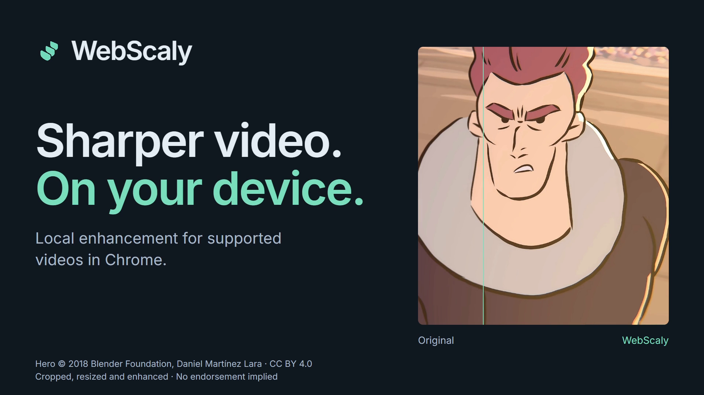

# WebScaly demonstrations

[Install from the Chrome Web Store](https://chromewebstore.google.com/detail/webscaly/hdcnniaagmhkocoeahemlpgjecgpchfa) · [Project README](../../README.md) · [Source credits and capture details](ATTRIBUTIONS.md)

These examples use **WebScaly 0.3.1**, **Anime4K CNN → Quality** and a **1080p output-height limit**. OFF shows native playback of the decoded source; ON shows actual extension output. Presentation crops and enlargement apply equally to both sides. Results depend on the source and device.

| Example | Decoded input | Output | Output scale |
| --- | --- | --- | --- |
| Illustration, new detail views | 640×360 | 1920×1080 | Automatic |
| Hero still and original video illustration | 960×540 | 1920×1080 | 2× |
| Hero wide held frame in the showcase | 960×402 | 1920×804 | 2× |

## Showcase video

[Watch on YouTube](https://www.youtube.com/watch?v=MHUyqf4pNGg) · [Download MP4 — 1080p, 44 seconds](WebScaly-showcase-1080p.mp4) · [English captions](WebScaly-showcase.en.vtt) · [File inventory and SHA-256 checksums](assets.json)

| Time | What the flagship shows |
| --- | --- |
| 0:00 | Branding and authentic split detail |
| 0:03 | Wipe over one matching captured Hero frame |
| 0:07 | Equally enlarged Hero detail |
| 0:10 | Matched detail from the 360p illustration |
| 0:13 | Actual website approval and method-control states |
| 0:21 | Actual in-player comparison UI, held captured frame |
| 0:25 | Output settings and site preferences |
| 0:29 | Spatial Detail, Anime4K and FSRCNNX |
| 0:34 | Local processing and site approval |
| 0:38 | Installation reference and credits |

The film includes licensed instrumental music and quiet interface cues. It uses matching held frames for clear comparisons; the 60 fps graphics timeline does not imply 60 fps enhancement throughput. No source-frame interpolation or post-production sharpening is used. Native Chrome permission approval is explained; the interface captures use a preapproved, isolated local website.

### Other formats

| Edit | YouTube | Download | Suitable use |
| --- | --- | --- | --- |
| 18-second horizontal social cut | [Unlisted video](https://www.youtube.com/watch?v=FtX5LE-ZEWM) | [1920×1080 MP4](WebScaly-social-1080p60.mp4) | Short horizontal previews |
| 18-second vertical cut | [Unlisted video](https://www.youtube.com/shorts/R_q0CDxLRJg) | [1080×1920 MP4](WebScaly-vertical-1080x1920.mp4) | Vertical mobile posts |

All three YouTube uploads are unlisted and allow embedding. Include [the full media and music attribution](ATTRIBUTIONS.md) when redistributing a video.

## Illustration — larger detail from a 360p source

The original illustration was downsampled and encoded as a **640×360 video before either capture**. OFF is that video's native playback; ON is actual Anime4K Quality output at 1920×1080 using Automatic scale. Both 304×144 crops are enlarged 3×. The editor does not blur the OFF side or sharpen the ON side.

[Large 1000×1340 detail](https://raw.githubusercontent.com/Lorcuz/WebScaly/main/docs/media/original-anime-360-detail-1000x1340.png) · [1280×800 store detail](https://raw.githubusercontent.com/Lorcuz/WebScaly/main/docs/media/original-anime-360-detail-1280x800.png) · [1920×1080 full frame](https://raw.githubusercontent.com/Lorcuz/WebScaly/main/docs/media/original-anime-360-comparison-1920x1080.png) · [1280×800 full frame](https://raw.githubusercontent.com/Lorcuz/WebScaly/main/docs/media/original-anime-360-comparison-1280x800.png)

This is original AI-generated demonstration artwork, separate from WebScaly's processing. It is not footage from an anime series. The flagship includes the labeled 360p detail example and an actual comparison-player capture using the 540p illustration source. These sources are identified separately.

## Hero — larger matched detail

960×540 input → 1920×1080 output. Identical 304×144 crops enlarged 3× make contours easier to inspect at GitHub page widths. Hero © 2018 Blender Foundation, Daniel Martínez Lara, [CC BY 4.0](https://creativecommons.org/licenses/by/4.0/). Excerpted, cropped, resized and enhanced; no endorsement implied. [Original film](https://studio.blender.org/projects/hero/).

[Large 1000×1340 detail](https://raw.githubusercontent.com/Lorcuz/WebScaly/main/docs/media/hero-detail-1000x1340.png) · [1280×800 store detail](https://raw.githubusercontent.com/Lorcuz/WebScaly/main/docs/media/hero-detail-large-1280x800.png)

## Hero — full frame

960×540 input → 1920×1080 output. Hero © 2018 Blender Foundation, Daniel Martínez Lara, [CC BY 4.0](https://creativecommons.org/licenses/by/4.0/). Excerpted, cropped, resized and enhanced; no endorsement implied. [Original film](https://studio.blender.org/projects/hero/).

[1920×1080 image](https://raw.githubusercontent.com/Lorcuz/WebScaly/main/docs/media/hero-comparison-1920x1080.png) · [1280×800 image](https://raw.githubusercontent.com/Lorcuz/WebScaly/main/docs/media/hero-comparison-1280x800.png)

## 540p illustration used in the player capture

960×540 input → 1920×1080 output, 2× scale. Both sides use the same decoded frame. This source has more initial detail than the new 360p example.

[1920×1080 full frame](https://raw.githubusercontent.com/Lorcuz/WebScaly/main/docs/media/original-anime-comparison-1920x1080.png) · [1920×1080 matched detail](https://raw.githubusercontent.com/Lorcuz/WebScaly/main/docs/media/original-anime-detail-1920x1080.png)

## Video thumbnail

[1920×1080 showcase thumbnail](WebScaly-thumbnail-1920x1080.png). It uses authentic branding and a matched Hero detail, with visible attribution.

## Reuse and attribution

Keep the visible credits when sharing the images or video. Read [ATTRIBUTIONS.md](ATTRIBUTIONS.md) for source licenses, modifications, fonts and icons. The extension's MIT code license does not replace the film's CC BY 4.0 license. These demonstrations do not establish support or performance on every website or physical GPU.
